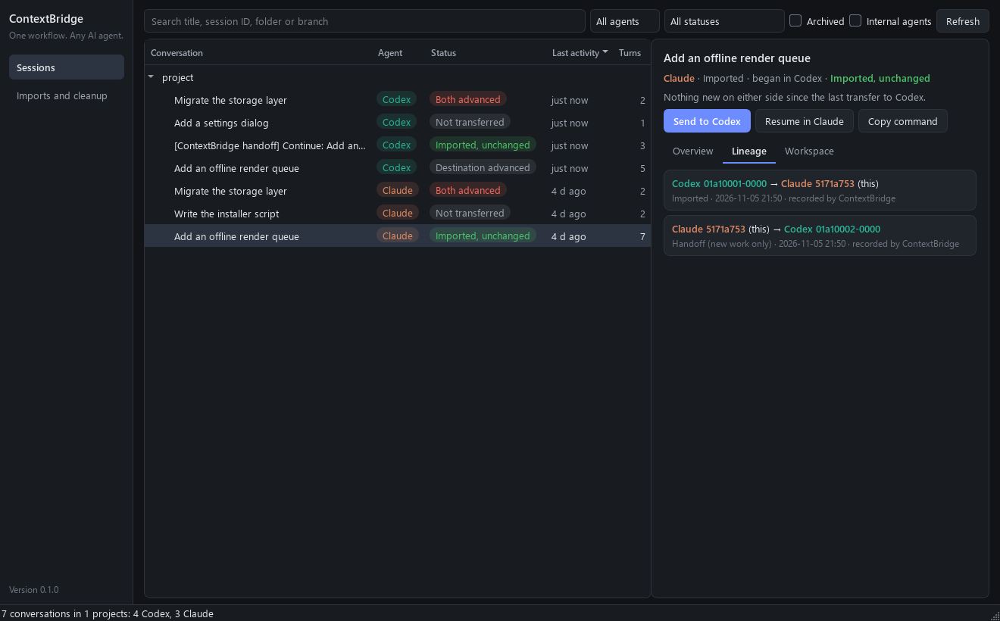
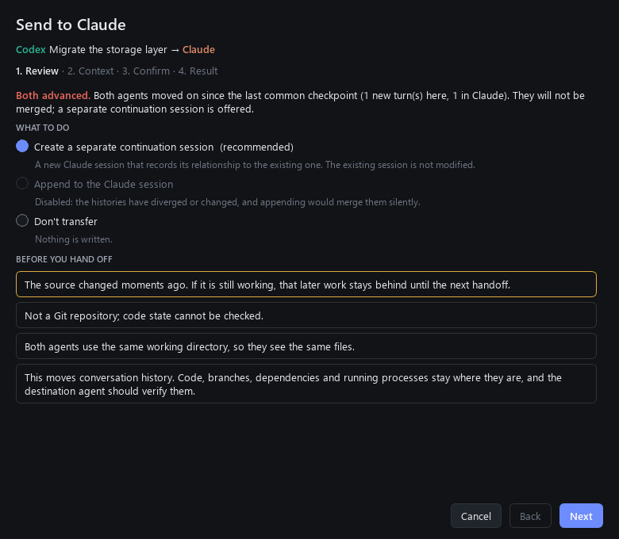

# ContextBridge

*One workflow. Any AI agent.*

Switch between OpenAI Codex and Claude Code without losing development context, duplicating
conversations or explaining a project again. ContextBridge is a Windows-first desktop app
(Python and PySide6) that finds your conversations in both agents, tracks how they relate, and
moves work between them safely.



## Install and run

```powershell
python -m venv .venv
.venv\Scripts\pip install -e .[gui]
.venv\Scripts\contextbridge-gui
```

You can also double-click `run_contextbridge.pyw` once `.venv` exists. Python 3.12 or newer is
required. Below 3.14, the `zstandard` package reads compressed Codex rollouts; it is installed
automatically.

To try it without touching your real sessions, point it at copies:

```powershell
.venv\Scripts\contextbridge --codex-home D:\try\.codex --claude-home D:\try\.claude --app-home D:\try\app gui
```

## A handoff

1. Find a conversation under **Sessions**. Conversations are grouped by project, and rollout
   revisions and Codex's internal agents are already folded away.
2. Select **Send to Claude** or **Send to Codex**.
3. **Review** what state the two sides are in, and pick a transfer type. Anything that would
   overwrite work is disabled, with the reason beside it. Merging diverged histories is never
   the default.
4. **Context**: set the budget and how earlier history is kept. The numbers recalculate as you
   change them, without writing anything or making a billable call.
5. **Confirm**, then read the report. **Open in Claude** or **Open in Codex** resumes the
   session in a terminal, or you can copy the command.

A completed transfer moves conversation history, nothing else. The destination agent still
needs the right code, branch and dependencies, so each handoff reports the repository's branch,
HEAD and uncommitted changes. ContextBridge never resets, cleans or stashes anything.



## What each status means

The status is always relative to the selected session.

| Status | Meaning | What you're offered |
|---|---|---|
| Not transferred | No recorded link to the other agent | A new session |
| Imported, unchanged | Neither side moved since the last checkpoint | Nothing to do |
| Source advanced | This session has work the other side lacks | Add only that work |
| Destination advanced | The other side has work this one lacks | Send from the other side |
| Both advanced | They diverged | A separate continuation, or a merge if you choose it |
| Destination missing | The linked session is gone | A new session |
| Source modified | History changed after it was transferred, for example by a revert | A separate continuation |
| Possible duplicate | Recorded provenance shows this is a copy | Review it under Imports and cleanup |
| Ambiguous lineage | Records disagree or the peer changed unexpectedly | Nothing by default; you choose |

Titles and folders never decide any of this. See [how lineage works](docs/ARCHITECTURE.md) and
[what has and has not been verified](docs/ARCHITECTURE.md#verification).

## Command line

The desktop app and `contextbridge` share one backend:

```powershell
contextbridge sessions --project MyRepo
contextbridge show 01a1ab29
contextbridge plan 01a1ab29 --to claude      # preview: no writes, no billable calls
contextbridge send 01a1ab29 --to claude --yes
contextbridge transfers
contextbridge duplicates
```

## Imports and cleanup

| Tab | What it's for |
|---|---|
| Transfers | Every past handoff and its report |
| Duplicates | Copies shown by recorded provenance, which you can archive |
| Archived | Everything moved aside, with **Restore** |
| Import health | Whether each import is intact: transcript present, source rollout present, Codex not ahead. It also finds imports missing from the ledger. **Remove selected** moves an import, its sidebar rows and its ledger entry to Archived. |
| Bulk import | Sends many Codex threads to Claude at once. New threads get a new session, and threads already in Claude get only their new turns. |
| Claude Desktop | Clears sidebar rows that open on "session not found", and copies rows from another account |

Nothing on these tabs deletes a transcript or a card. Everything moves to
`~/.contextbridge/archive/` and can be put back. Sessions with native Claude work can't be removed.
Bulk import runs the same checks as a single handoff, so it skips threads in use. Diverged threads
stay unticked; ticking one merges it. To keep a diverged thread separate, use **Send to Claude**.

## Merging diverged threads

When both agents have moved on, a separate continuation is recommended and already selected.
**Merge the new Codex turns into the Claude session** is the other choice. It adds the Codex turns
after Claude's own newer turns, once a backup exists, and Claude then reads both branches as one
conversation even where they disagree. Claude's turns still haven't reached Codex, so the session
then shows as having work to send. Sending it later carries only Claude's own turns. Merging only
goes from Codex to Claude.

Quit Claude Desktop before changing its rows if you can. It keeps its session list in memory and
can write rows back, and it needs a restart to show new ones.

## Keeping within the context window

A full Codex transcript can be much larger than Claude's context window. A context budget builds
a smaller working view: recent turns stay whole, large older tool output is shortened with
tool-use and result pairs kept valid, and older turns are replaced by a note. The source rollout
is never changed, so Claude can still go back to it.

Choose how earlier history is kept:

| Option | What it does | Cost |
|---|---|---|
| Evidence index (default) | Labeled excerpts of earlier requests, outcomes and diagnostic output. It quotes the history and doesn't summarize it. | None; runs offline |
| AI summary | `claude -p` summarizes the omitted history in chunks, without tools, citing source turns. Unsupported output stops the transfer. | Uses your Claude account, and you authorize each run |
| From a file | A summary you wrote or reviewed | None |
| Off | Only the note listing what was left out | None |

Budgets are estimates (UTF-8 bytes divided by two), not Claude's token counter, and they run high.
Check Claude's context meter after opening a session.

## Transcript modes

**Faithful** (the default) writes real `tool_use` and `tool_result` pairs, so a session looks like
a native one. Codex `exec` and `shell` become `Bash`, MCP tools keep their `mcp__*` names, and
anything else gets a `codex__` prefix so it can't pass for a real tool.

**Archive** flattens tool calls and output into readable text, so no foreign tool names reach the
API. Use it when you mainly want the history searchable.

## What doesn't carry over

User and assistant turns, tool calls, tool output, timestamps and the working directory all carry
over. These don't:

- **Reasoning, mostly.** Codex stores it encrypted, usually with an empty plaintext summary. Any
  text that can be recovered becomes plain text, because Claude `thinking` blocks need a signature
  that can't be created.
- **Session details:** token accounting, rate-limit snapshots, sandbox and permission profiles,
  web-search result cards and compaction history.

## Where things are kept

Each transfer is recorded in more than one place, so losing one record doesn't lose the link:

- **`~/.contextbridge/`** holds the lineage database, reports, backups, handoff files and archived
  sessions.
- **`~/.claude/codex-imports.json`** lists which Codex thread went to which Claude session, and how
  far. Imports from earlier versions of this tool are recognized from this file.
- **Each imported transcript** starts with a background note naming its source, and ends with a
  machine-readable provenance record.

Before an existing transcript is changed, a copy goes to `~/.claude/codex-import-backups/`.

## Tests

```powershell
python -m unittest discover -s tests -p "test_*.py"
```

| File | Covers |
|---|---|
| `tests/test_convert.py`, `tests/test_summary.py` | The converter, budgets and summaries |
| `tests/test_lineage_scenarios.py` | The acceptance scenarios, including Codex to Claude to Codex to Claude, on synthetic homes |
| `tests/test_maintenance.py` | Import health, removal and restore, bulk import, Claude Desktop rows and account moves |
| `tests/test_gui.py` | The real window, dialog and pages, driven offscreen. Skipped without PySide6. |
| `tests/test_cli.py` | The `contextbridge` command line |
| `tests/test_real_codex.py` | The real `codex app-server` in an isolated `CODEX_HOME`. Set `CONTEXTBRIDGE_REAL_CODEX=1` to run it; it makes no model calls. |

## Layout

```
src/contextbridge/                 discovery, lineage database, handoffs, reports, CLI
src/contextbridge/converter.py     Codex rollouts to Claude transcripts
src/contextbridge/context_budget.py    bounded working views
src/contextbridge/history_summary.py   evidence indexes and AI summaries
src/contextbridge/desktop_register.py  the Claude desktop app's session cards
src/contextbridge/maintenance.py   import health, removal, sidebar rows, account moves
src/contextbridge/ui/              the PySide6 interface
docs/ARCHITECTURE.md               lineage model, Codex findings, limitations, verification
```
